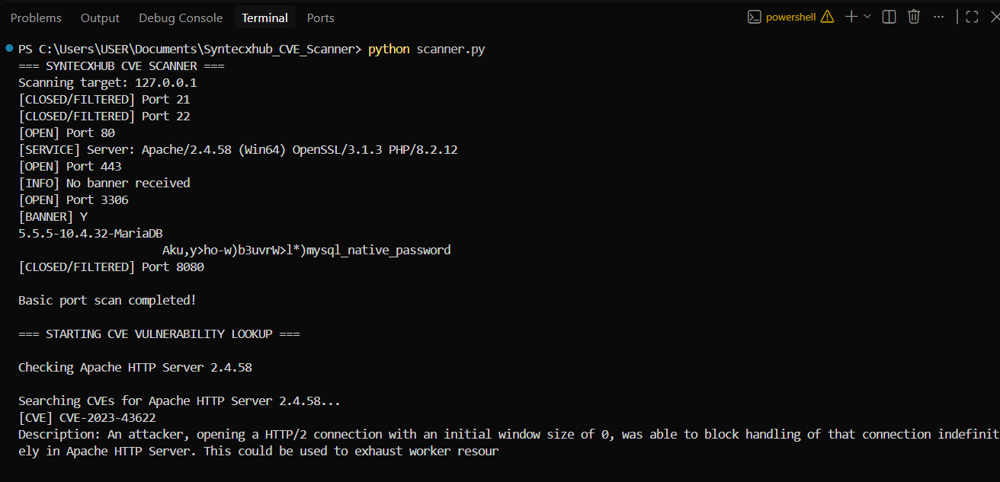
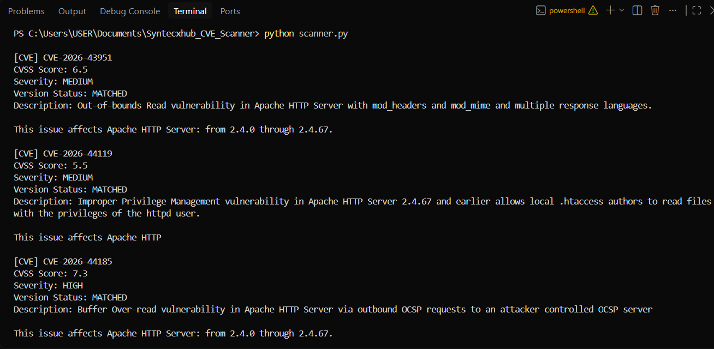

# 🔐 Syntecxhub CVE Vulnerability Scanner

## 📌 Project Overview

A Python-based CVE Vulnerability Scanner developed as part of the **Syntecxhub Cybersecurity Internship Program – Week 4**.

This project demonstrates basic vulnerability assessment by scanning local network services, identifying open ports, collecting service information, and searching for publicly disclosed vulnerabilities using the National Vulnerability Database (NVD) API.

The scanner performs version-aware CVE matching, extracts CVSS scores and severity ratings, and automatically generates a security assessment report.

**Testing Environment:** Localhost (127.0.0.1) using XAMPP.

---

## 🎯 Project Objectives

- Identify open TCP ports on a local system.
- Detect running services through banner grabbing.
- Identify software versions.
- Search for known CVEs using the NVD API.
- Compare software versions against affected-version information.
- Retrieve CVSS scores and vulnerability severity.
- Generate automated vulnerability assessment reports.
- Provide basic security recommendations.

---

## 🚀 Features

### 1. TCP Port Scanning
Scans selected TCP ports to identify accessible services.

Tested ports:
- 21 – FTP
- 22 – SSH
- 80 – HTTP
- 443 – HTTPS
- 3306 – MySQL/MariaDB
- 8080 – Alternative HTTP

### 2. Service Detection
Uses socket connections and banner grabbing to collect available service information.

Examples:
- Apache HTTP Server
- MariaDB Database Server

### 3. CVE Vulnerability Lookup
Integrates with the NVD CVE API 2.0 to retrieve publicly documented security vulnerabilities.

### 4. Version-Aware CVE Matching
Uses CPE information and version boundaries to identify potential vulnerabilities affecting selected software versions.

The matching process checks:
- VersionStartIncluding
- VersionStartExcluding
- VersionEndIncluding
- VersionEndExcluding

Complex configurations may require additional manual verification.

### 5. CVSS Severity Analysis
Retrieves available CVSS information, including:
- CVE ID
- CVSS Base Score
- Severity Rating
- Vulnerability Description
- Version Match Status

### 6. Automated Reporting
Generates a text-based security report containing:
- Scan date and target
- Identified services
- Potential CVE matches
- CVSS scores and severity
- Version matching status
- Security recommendations
- Disclaimer

---

## 🛠️ Technologies Used

| Technology | Purpose |
|------------|---------|
| Python | Main programming language |
| Socket | TCP port scanning and banner grabbing |
| Requests | NVD API communication |
| NVD CVE API 2.0 | Vulnerability information |
| CVSS | Vulnerability severity scoring |
| XAMPP | Local testing environment |
| Visual Studio Code | Development environment |
| Git & GitHub | Version control |

---

## 📂 Project Structure

Syntecxhub_CVE_Scanner/
│
├── scanner.py
├── cve_lookup.py
├── requirements.txt
├── README.md
├── .gitignore
│
├── reports/
│   └── cve_scan_report.txt
│
└── screenshots/
    ├── port_scan.png
    ├── cve_results.png
    ├── scan_report.png
    └── security_recommendations.png

---

## ⚙️ Installation and Setup

### Step 1: Clone the Repository

```bash
git clone https://github.com/bhagyranaweera/Syntecxhub_CVE_Scanner.git
```

### Step 2: Navigate to the Project Folder

```bash
cd Syntecxhub_CVE_Scanner
```

### Step 3: Install Required Dependencies

```bash
python -m pip install -r requirements.txt
```

### Step 4: Start Local Services

Start Apache and MySQL/MariaDB through the XAMPP Control Panel.

### Step 5: Run the Scanner

```bash
python scanner.py
```

An internet connection is required for NVD API lookups.

---

## 🔍 How It Works

1. The scanner connects to the localhost target.
2. It checks predefined TCP ports.
3. Open ports and available service banners are displayed.
4. The configured software names and versions are passed to the CVE lookup module.
5. The module queries the NVD API.
6. CVE configurations and version ranges are checked.
7. CVSS scores, severity, and matching statuses are collected.
8. The results are saved to a text report.

---

## 📊 Example Scan Output

```text
=== SYNTECXHUB CVE SCANNER ===

Scanning target: 127.0.0.1

[OPEN] Port 80
[SERVICE] Server: Apache/2.4.58

[OPEN] Port 443

[OPEN] Port 3306
[BANNER] MariaDB 10.4.32

Basic port scan completed!

=== STARTING CVE VULNERABILITY LOOKUP ===

Checking Apache HTTP Server 2.4.58
Searching CVEs...

Checking MariaDB 10.4.32
Searching CVEs...

CVE lookup completed!

Report generated: reports/cve_scan_report.txt
```

---

## 🛡️ Example CVE Findings

The following findings were returned during local testing.

### CVE-2026-3494

- Product: MariaDB
- CVSS Score: 5.3
- Severity: MEDIUM
- Version Status: MATCHED
- Verification: Required

### CVE-2026-35549

- Product: MariaDB
- CVSS Score: 6.5
- Severity: MEDIUM
- Version Status: MATCHED
- Verification: Required

**Note:** These are potential version matches returned by the lookup process. They do not confirm that the tested installation is vulnerable.

---

## 📄 Generated Report

The scanner automatically generates:

`reports/cve_scan_report.txt`

The report includes identified services, CVE information, CVSS severity ratings, version-matching results, and security recommendations.

---

## 📸 Project Screenshots

### Port Scanning Results



### CVE Lookup Results



### Generated Vulnerability Report


### Security Recommendations


---

## 🔒 Security Recommendations

1. Keep operating systems and applications updated.
2. Review official security advisories regularly.
3. Verify software versions against published CVE information.
4. Disable unnecessary network services.
5. Apply appropriate security patches.
6. Perform regular authorized vulnerability assessments.
7. Validate findings before classifying them as confirmed vulnerabilities.

---

## ⚠️ Limitations

- The scanner is configured for localhost testing.
- Only predefined TCP ports are scanned.
- Software versions used for CVE lookups are currently configured manually.
- Service banner detection is limited.
- Version matching uses simplified numeric comparisons.
- Complex CPE configurations and environmental dependencies may not be fully evaluated.
- CVE matches do not confirm exploitability.
- NVD API connectivity is required.

---

## 🔮 Future Improvements

- Automatic software version extraction from service banners.
- More comprehensive CPE configuration evaluation.
- Support for additional services and software.
- HTML and PDF vulnerability reports.
- CVE filtering by severity.
- Interactive dashboard.
- Improved vulnerability verification and reporting.

---

## ⚖️ Disclaimer

This project was developed for educational purposes as part of the Syntecxhub Cybersecurity Internship Program.

All testing was performed against an authorized local environment.

The scanner identifies potential vulnerabilities using publicly available CVE information. Findings require manual verification before being considered confirmed security issues.

---

## 👩‍💻 Developer

**Bhagya Ranaweera**

Cybersecurity Graduate

Syntecxhub Cybersecurity Internship Program – Week 4

GitHub: https://github.com/bhagyranaweera

---

## 📜 Internship Project

**Organization:** Syntecxhub

**Program:** Cybersecurity Internship

**Week:** 4

**Project:** CVE Vulnerability Scanner

**Status:** Completed
